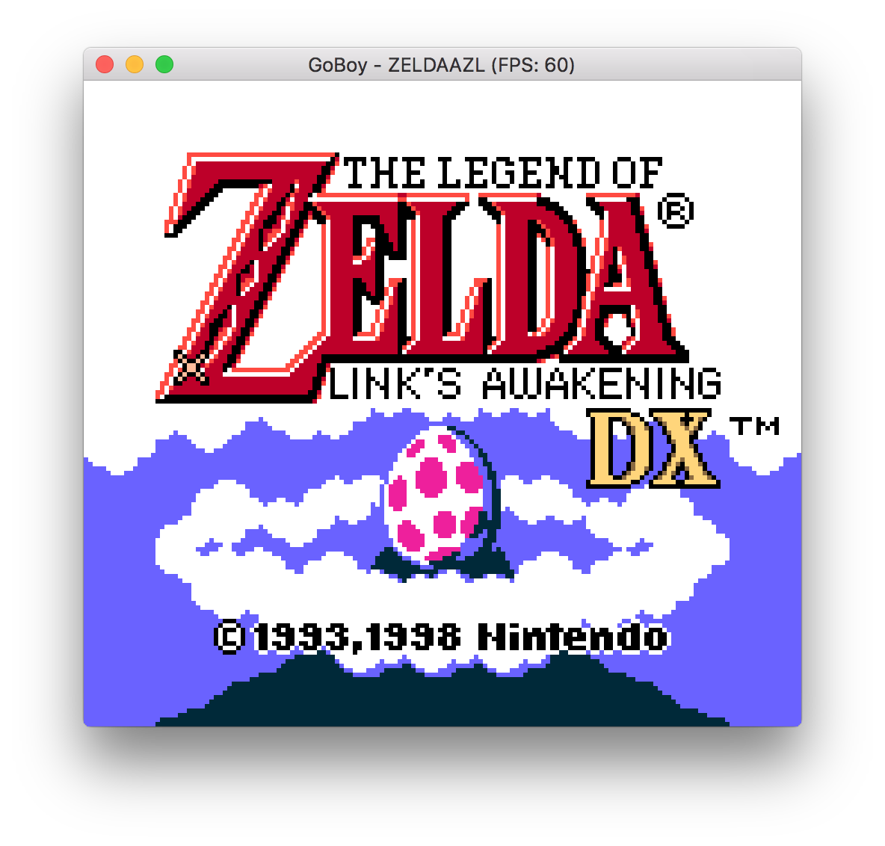
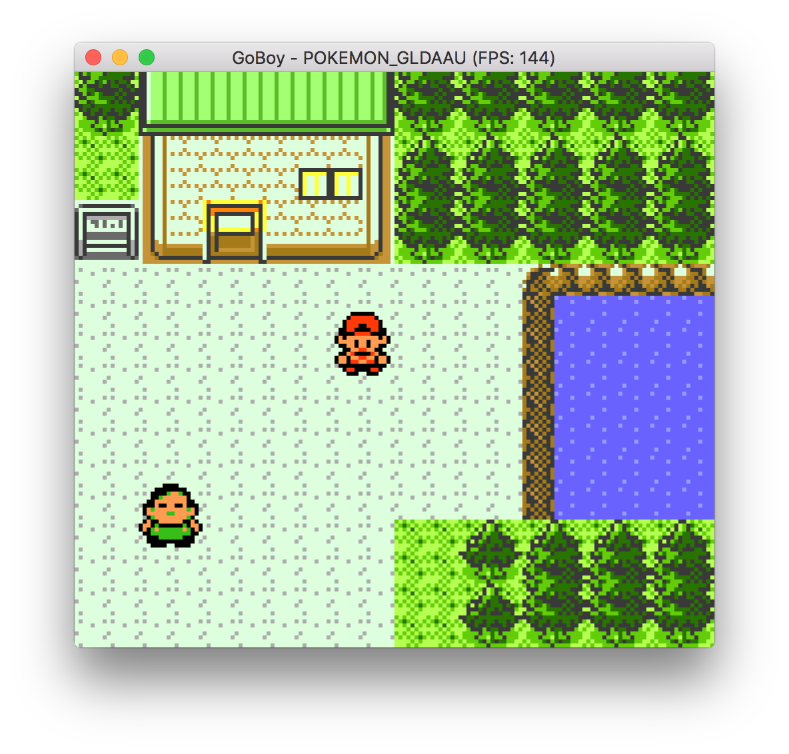
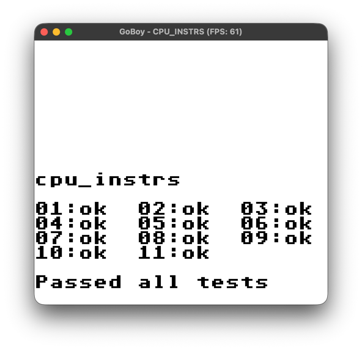
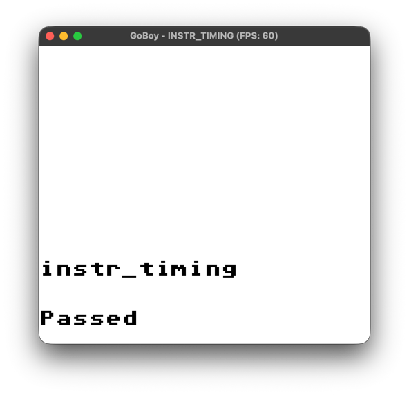
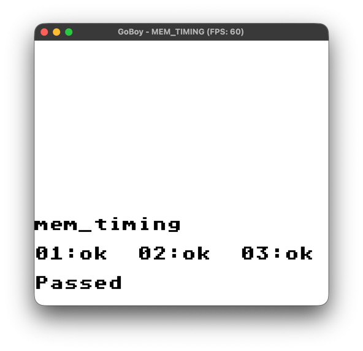
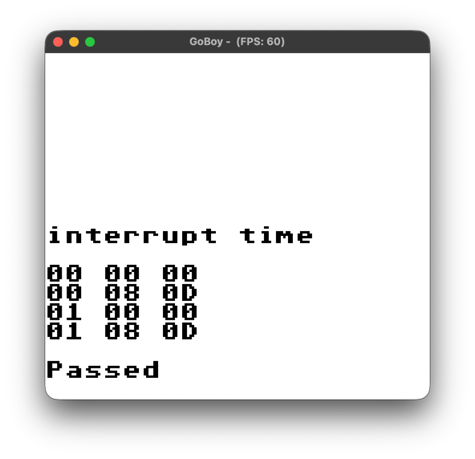
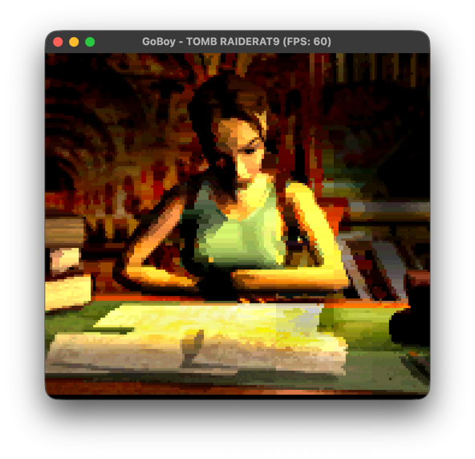
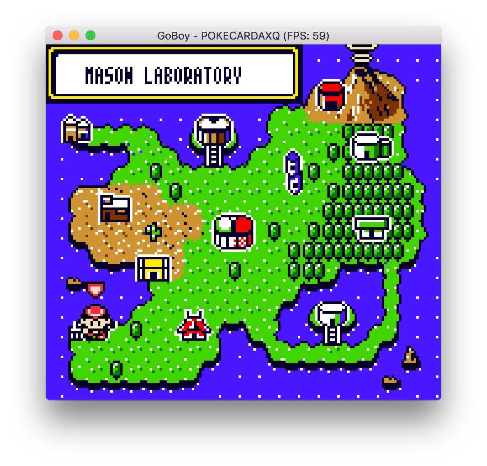
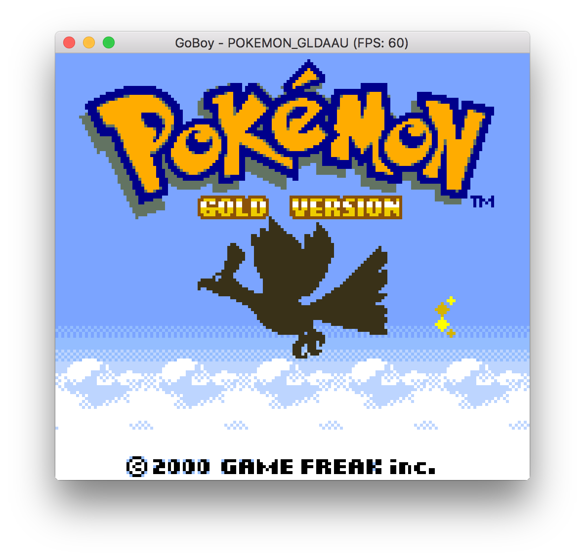
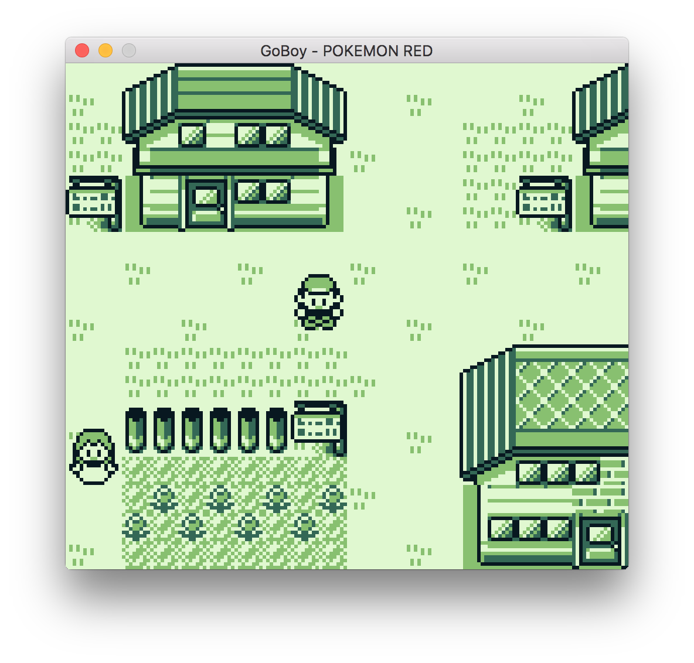

# GoBoy

[](https://github.com/Humpheh/goboy/actions/workflows/test.yaml)
[](https://goreportcard.com/report/github.com/Humpheh/goboy)
[](https://pkg.go.dev/github.com/Humpheh/goboy)

GoBoy is a multi-platform Nintendo GameBoy and GameBoy Color emulator written in go.
The emulator can run the majority of GB games and CGB games.
Please feel free to contribute if you're interested in GameBoy emulator development.



The program includes debugging functions making it useful for understanding the emulator operation for
building one yourself. These functions include printing of opcodes and register values to the console at each
step (although will greatly slow down the emulation) and toggling of individual sound channels.

## Installation

Download the [latest release](https://github.com/Humpheh/goboy/releases/latest) of GoBoy from the releases page. 

### Building from source

GoBoy requires Go 1.25 or later. With Go installed, you can install GoBoy into your go bin by running:
```sh
go install github.com/Humpheh/goboy/cmd/goboy@latest
```

Or build it from a clone of the repository:
```sh
git clone https://github.com/Humpheh/goboy.git
cd goboy
go build -o goboy ./cmd/goboy
```

GoBoy is compatible with macOS, Windows and Linux. It uses [Ebitengine](https://ebitengine.org) for
graphics and input, and [Oto](https://github.com/ebitengine/oto) for sound. 

Thanks to Ebitengines support, GoBoy can run on these platforms with no cgo required:
- Windows
- macOS
- Linux
- WebAssembly
- FreeBSD

See the [Ebitengine install guide](https://ebitengine.org/en/documents/install.html) for other platforms including Android, iOS, Nintendo Switch and Xbox.

## Usage 
```sh
goboy zelda.gb
```
Controls: <kbd>&larr;</kbd> <kbd>&uarr;</kbd> <kbd>&darr;</kbd> <kbd>&rarr;</kbd> <kbd>Z</kbd> <kbd>X</kbd> <kbd>Enter</kbd> <kbd>Backspace</kbd>

Hold <kbd>Tab</kbd> to fast-forward at 2x speed, and press <kbd>F</kbd> to toggle fullscreen.

Other options:
```sh
  -dmg
    	set to force dmg mode
  -mute
    	mute sound output
```

Debug or experimental options:
```sh
  -debug
    	enable debug functionality on startup
  -cpuprofile string
    	write cpu profile to file (debugging)
  -disableVsync
    	set to disable vsync (debugging)
  -stepthrough
    	step through opcodes (debugging)
  -unlocked
    	if to unlock the cpu speed (debugging)
```

### Debugging
There are a few keyboard shortcuts useful for debugging. They are only active while debug
functionality is enabled, which can be toggled with <kbd>\</kbd> or turned on at startup with `-debug`:

<kbd>Esc</kbd> - pause/resume emulation<br/>
<kbd>=</kbd> - cycle the colour palette (DMG mode)<br/>
<kbd>Q</kbd> - force toggle background<br/>
<kbd>W</kbd> - force toggle sprites<br/>
<kbd>D</kbd> - print background map to log<br/>
<kbd>E</kbd> - toggle opcode printing to console (will slow down execution)<br/>
<kbd>7,8,9,0</kbd> - toggle sound channels 1 through 4.

### Saving 
If the loaded rom supports a battery a `<rom-name>.sav` (e.g. `zelda.gb.sav`) file will be created
next to the loaded rom containing a dump of the RAM from the cartridge. A loop in the program will
update this save file every second while the game is running.

## Tests
GoBoy currently passes Blargg's `cpu_instrs`, `instr_timing`, `mem_timing` and `interrupt_time` test roms,
and Mooneye's `sprite_priority` test.



These roms are included in the source code under `roms/` along with tests in `pkg/gb` that check the
output is as expected. Run them with `go test ./...`; they are also run by GitHub Actions on each commit.

## Contributing

Please feel free to open pull requests to this project or play around if you're interested! There are
still plenty of small bugs that can easily be found through playing games on the emulator, or take a
task from the TODO list below!

## Known Bugs and TODO list
- [ ] Minor APU timing issues
- [ ] MBC3 clock support
- [ ] Platform native UI?
- [ ] More DMG colour palettes
- [ ] Support save-states
- [ ] Support boot roms
- [ ] [Blargg's test ROMs](http://gbdev.gg8.se/wiki/articles/Test_ROMs)





## Resources
A large variety of resources were used to understand and test the GameBoy hardware. Some of these include:
* <http://www.codeslinger.co.uk/pages/projects/gameboy/files/GB.pdf>
* <https://github.com/retrio/gb-test-roms>
* <http://www.codeslinger.co.uk/pages/projects/gameboy/beginning.html>
* <http://bgb.bircd.org/> - invaluable for debugging
* <https://github.com/AntonioND/giibiiadvance/tree/master/docs>
* <https://github.com/trekawek/coffee-gb>
